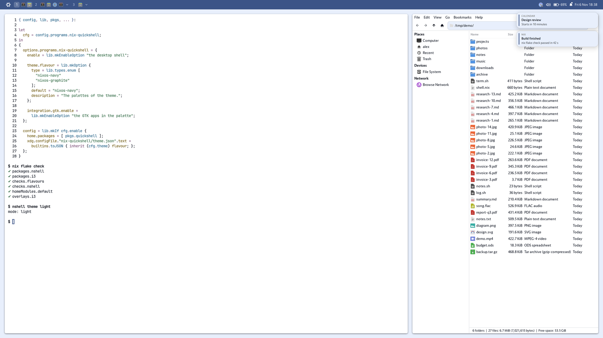
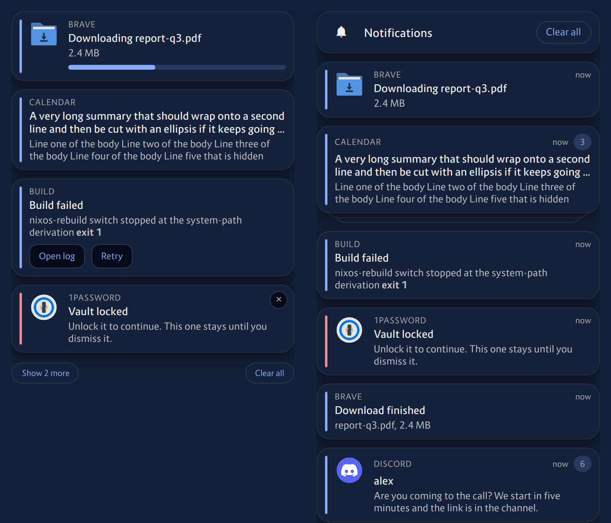
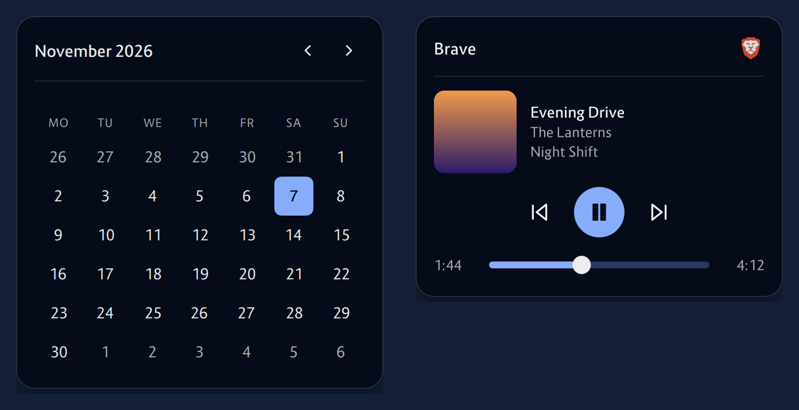
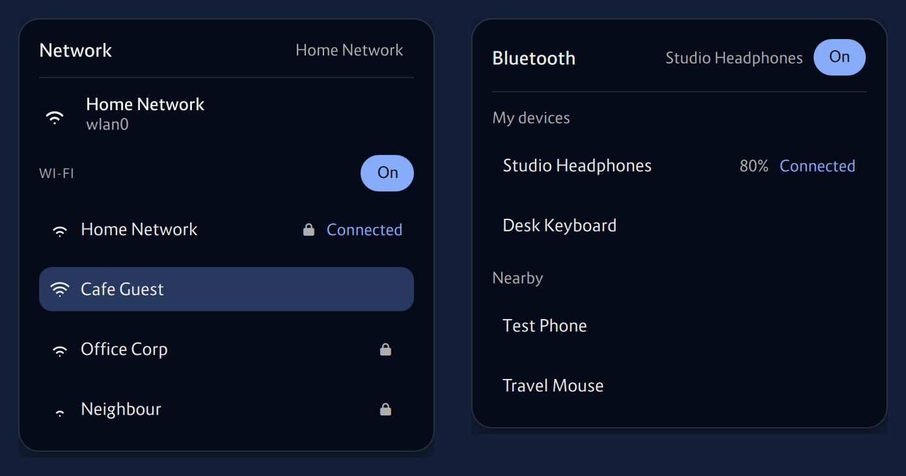
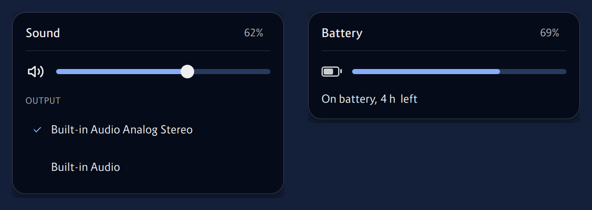
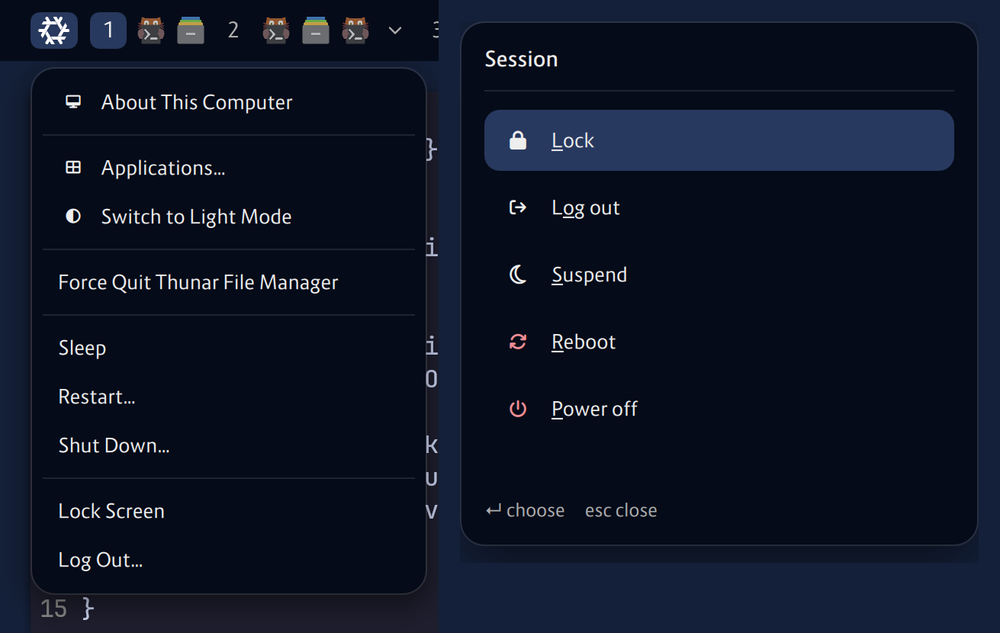
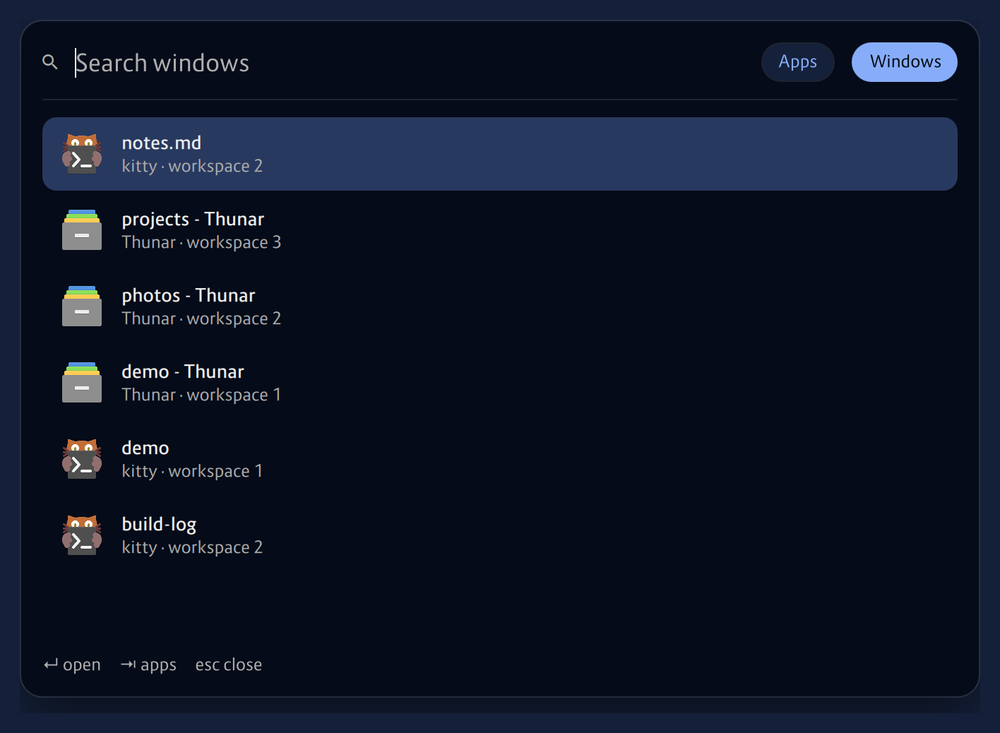
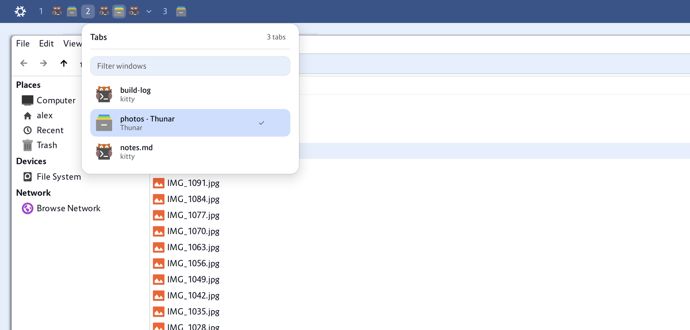

# nix-quickshell

[](https://github.com/nixos-contrib/nix-quickshell/actions/workflows/ci.yml)
[](https://github.com/nixos-contrib/nix-quickshell/releases/latest)
[](https://nixos.org)
[](LICENSE)

A desktop shell for NixOS on X11, written in QML for
[Quickshell](https://quickshell.org). The bar and its popups (media, network,
Bluetooth, sound, battery, calendar), the notifications, the launcher, the
session menu, the volume pill and the polkit agent of an i3 session are one
process, in the palette, the typeface and the logo of NixOS. A home-manager
module makes the GTK apps, xterm, zathura, i3 and the wallpaper follow its
dark and light mode.

<p align="center">
  <picture>
    <source media="(prefers-color-scheme: dark)" srcset="docs/img/desktop-dark.png">
    
  </picture>
</p>

> [!WARNING]
> This project is a work in progress and has no release yet. Interfaces may
> change without notice.

## Why

There are many good shells for Quickshell, but most of them are for Wayland
compositors. This one is a modern look for **i3 on X11**: flat panels with a
hairline edge and a soft shadow, one palette, one typeface, and a bar that shows
the windows. It is made for working in **NixOS in a virtual machine on macOS**.
The VM has to follow the window it is in, and in our tests sway under Parallels
Desktop on Apple Silicon did not, so the display stayed the wrong size, and
swiping lagged. X11 and i3 do both, and a tiling window manager with tabs is
what the work needed. So the shell gives i3 the aesthetics that the Wayland
shells have, and it was built and tested in a VM of that kind. It is not tied to
one: it is an X11 shell, and runs wherever i3 does.

## Features

- **Notifications.** A server and toasts, with urgency, actions, markup, icons,
  a close button on hover, a stack with show more and clear all, a progress bar
  for an app that sends the `value` hint (and updates the same card as it goes),
  more than two of one app as one card, with edges behind it and its count as a
  badge, which opens to the list, a field for the reply when the app offers one
  (the `inline-reply` action of KDE), and a history (`nshell center`) that groups the
  same way. Its bell is the switch of do not disturb. Do not disturb also mutes the sound
  effects of chat apps (Vesktop, Discord) while it is on, see
  `modules/notifications/QuietSound.qml`.

  <p align="center">
    
  </p>
- **Bar.** The logo, the workspaces of i3 with the windows in them (below), the
  tray (StatusNotifierItem) with menus in the style of the shell, and a status
  area of popups that share one look. An item is not there when the machine has
  nothing for it (no player, no adapter, no battery).

  <p align="center">
    <picture>
      <source media="(prefers-color-scheme: dark)" srcset="docs/img/bar-dark.png">
      
    </picture>
  </p>

  - **Media.** Any player that speaks MPRIS: its title and artist, the cover,
    previous, play and pause, next, the position, the icon of the app, which
    takes its window to the front, and the other players.
  - **Network.** With NetworkManager a cable or a Wi-Fi: the networks to join,
    with a field for the password, and the right button turns the Wi-Fi off and
    on. Without it, the wired interface and its address. A click on the
    address, the gateway or the hardware address copies it (the address
    without its prefix length), with `xclip` in the path.
  - **Bluetooth.** The devices that are paired and the ones in range, to
    connect, disconnect, pair and forget, with the battery of the one that says
    it. A device that asks for a code cannot be paired: Quickshell has no
    pairing agent.
  - **Sound** (volume, mute, outputs), **battery**, the **bell**, with a dot when
    something came since the history was last opened, and the **clock**, which
    opens a calendar of the month: the week starts on Monday or Sunday, Left,
    Right and the wheel go from month to month, and Today is the way back
    (`nshell calendar` opens it from a key).

  <p align="center">
    <br>
    <br>
    
  </p>
- **The menu of the logo,** as the Apple menu: About This Computer, Applications…,
  the mode of the theme, Force Quit for the app that has the focus, Sleep,
  Restart…, Shut Down…, Lock Screen and Log Out…. The lines with dots ask once
  more, in a card in the middle of the screen.

  <p align="center">
    
  </p>
- **Session.** That card, with Lock, Log out, Suspend, Reboot and Power off, each
  with a key (the underlined letter), opens from a key with `nshell session`.
  Lock is only there when `session.lock` is set: X11 has no lock screen
  for a shell to draw, so it runs yours.
- **Windows in the bar.** After the number of every workspace, an icon for
  each of its windows, the one in front or with the focus lit, a title when the
  pointer stays on an icon, and a click takes the window to the front. Windows
  side by side are one group; a tabbed container of i3 is a group of its own
  with a chevron, which, or `nshell tabs list`, opens the list of its tabs with
  titles and a filter. A group of more than five windows is one icon, the one in
  front, with the same chevron and its list: there are no counts in the bar. The
  right button on an icon opens a menu (close, and move a tab left or right), a
  drag along a group of tabs moves the tab to where it is let go, and the wheel
  on a group goes from one window to the next. i3 draws nothing for its tabs,
  see [`docs/i3.md`](docs/i3.md).
- **Launcher.** Apps (ordered by how often they are run), the windows of
  i3 and the history of the clipboard, Tab goes from one to the next
  (`nshell launcher`, `nshell launcher windows`, `nshell launcher clipboard`;
  the history is [`docs/clipboard.md`](docs/clipboard.md)). An app that has a window is focused and not
  started again, by the `StartupWMClass` of its desktop entry, also from a key:
  `nshell launch brave-browser`. `nshell pick` is the same list for scripts.

  <p align="center">
    
  </p>
- **Volume OSD.** A pill at the bottom of the screen that shows the volume (or
  muted) for a moment when it changes, whatever changed it: the keys, the wheel
  on the bar, the slider, another app. It watches the sound, so there is no
  command for it. The keys are yours to bind, see [`docs/i3.md`](docs/i3.md).
- **Polkit agent.** A card for the touch of the key or the password, with its
  own layout for 1Password unlocking with the system.
- **Theme.** Two themes, `nixos-navy` (the blues of nixos.org) and
  `nixos-graphite` (greys), each with a dark and a light mode. The bar is the
  color of the windows on dark, and a blue (a dark grey in graphite) with white
  text on light.
  `nshell theme [dark|light|auto|toggle]` changes it live. The palettes are
  data, see [Theme](#theme).

<p align="center">
  <picture>
    <source media="(prefers-color-scheme: dark)" srcset="docs/img/tabs-dark.png">
    
  </picture>
</p>

Not done yet: brightness (needs a screen with a backlight).

## Try it

```sh
nix run github:nixos-contrib/nix-quickshell                    # the shell
nix run github:nixos-contrib/nix-quickshell -- center          # the history of the notifications
```

It needs i3 on X11 and a compositor such as picom. `QS_ICON_THEME` has to name
an installed icon theme, for the icons of the apps, and `I3SOCK` has to be set
when it runs outside i3. The windows of the toasts, the popups and the launcher
are floated by i3, see the rules in [`docs/i3.md`](docs/i3.md).

From a checkout, `NSHELL_PATH=. nshell` runs the shell, `scripts/preview` sends one
of every kind of notification and `scripts/preview burst` a pile of them.
`NSHELL_NO_BAR=1` runs it without the bar, to try the notifications beside
another one.

The launcher lists programs that run in a terminal (Helix, Yazi, bottom…) only
when `TERMINAL` is set in the session, to a terminal that takes `-e command`
(`xterm`, `alacritty`, `foot`…), and runs them in it. Without it they are not
listed, as they would have nowhere to open.

## Install

A flake input, and the home-manager module:

```nix
{
  inputs.nix-quickshell = {
    url = "github:nixos-contrib/nix-quickshell";
    inputs.nixpkgs.follows = "nixpkgs";
  };

  # in the configuration of home-manager
  imports = [ inputs.nix-quickshell.homeModules.default ];
  programs.nix-quickshell.enable = true;
}
```

The i3 that the tabs need has a small patch (the room above a tabbed container,
the gap inside tabs, and the tabs that are not in front unmapped). It is an
overlay, and it applies to the i3 of the pkgs that it is used with:

```nix
nixpkgs.overlays = [ inputs.nix-quickshell.overlays.i3 ];
```

`nix build .#i3` says if the patch still applies. Without it the shell works,
with a band of font height and 4 px above the tabbed containers. See
[`docs/i3.md`](docs/i3.md).

## Theme

<p align="center">
  <br>
  
</p>

The palettes are themes, files of the package: `themes/nixos-navy.json`
(the default) and `themes/nixos-graphite.json`, each with the roles of a
`dark` and a `light` palette. `~/.config/nix-quickshell/theme.json`, or the
file of `NSHELL_THEME`, is read over it, and the shell reads both again when
they change:

```json
{
  "name": "nixos-navy",
  "mode": "dark",
  "font": "Route 159",
  "radius": 16,
  "hours": { "light": 7, "dark": 19 },
  "calendar": { "weekStart": "monday", "weekNumbers": false },
  "session": { "lock": "i3lock", "logout": "i3-msg exit" },
  "dark": { "primary": "#7ebae4" }
}
```

Every key is optional. `name` is `nixos-navy` or `nixos-graphite`. `mode` is
`dark`, `light` or `auto` (light from 07:00 to 19:00 by default; a choice of
`nshell theme` is kept in `~/.local/state/nix-quickshell/theme.json` and lasts
over it). `font` is the family: Route 159 by default, the typeface of NixOS,
which has to be installed (nixpkgs has it as `route159`). It has the Latin
letters and little more, so the module adds a fontconfig rule that makes
Inter (`theme.fallbackFont`) draw the rest. `radius` is the large one and the
other two follow it. `calendar` is the week of the calendar under the clock:
`weekStart` is `monday` or `sunday`, and `weekNumbers` shows the ISO number of each
week. `session` has the command of each line of the menu of the session (`lock`,
`logout`, `suspend`, `reboot`, `poweroff`): `lock` has none by default and then the
menu has no Lock, and the others are `i3-msg exit` and `systemctl suspend`, `reboot`
and `poweroff`. `dark` and `light` name the roles to change.

### With Nix

The module writes that file from options, and what the **targets** need: a target
is a program or a part of the desktop that follows the theme (the GTK apps, the
wallpaper, the cursor, i3, a terminal). `theme` says how it looks, and `targets`
where that look goes:

```nix
programs.nix-quickshell = {
  enable = true;

  theme = {
    name = "nixos-navy";
    mode = "auto";                  # dark | light | auto
    font = "SF Pro Text";         # and fontSize, 11: the text of the GTK apps and of zathura
    dark.primary = "#7ebae4";       # the roles of a palette to change
  };

  targets = {
    autoEnable = true;              # kitty when programs.kitty is on, and so on
    gtk.enable = true;              # the settings and the colors of the GTK apps (adw-gtk3), GTK 3 and 4
    wallpaper.enable = true;        # the wallpaper of the theme, for each mode
    zathura.enable = true;          # the colors of an app, see Apps below
    i3.enable = true;               # the colors of the tabs, `include ~/.local/state/nix-quickshell/i3.conf` in the config of i3
  };

  calendar.weekStart = "monday";
  session.lock = "i3lock";          # also logout, suspend, reboot and poweroff
  network.interface = null;         # the one of the default route
};
```

| Option | Writes | Yours to add |
|---|---|---|
| `targets.gtk` | two GTK themes in `~/.local/share/themes`, `nix-quickshell-dark` and `nix-quickshell-light` (adw-gtk3 with the named colors of the palette after it), each with a twin of the same look (`-twin`), `gtk-3.0/settings.ini` and `gtk-4.0/gtk.css`, and `xsettings-<mode>.conf` and its twin for xsettingsd | `menuImages` (icons in the menus, on), `extraCss` (layout rules that can use the colors, as `@window_bg_color`), `xsettings` (as `Xft/DPI`), `iconTheme` (`dark`, `light` and `package`) |
| `targets.wallpaper` | `wallpaper-<mode>.png`, the surface color of the palette, a step off the bar, with the logomark of NixOS, the one with the gradient, in the middle, and `nshell apps` sets the one of the mode with feh | `image`, an image of your own: one for both modes, or `{ dark = ./night.png; light = ./day.png; }` |
| `targets.cursor` | the cursor theme (capitaine-cursors, the arrow of macOS, by default): its package, `icons/default/index.theme`, the cursor of GTK and `Xresources`, and `session.sh` | `. ~/.config/nix-quickshell/session.sh` in the session, and `size`: 24 by default, 48 on a screen with twice the pixels |
| `targets.portal` | `portal`, a marker, and the package of dconf: `nshell apps` writes `prefer-dark` or `prefer-light` in org.gnome.desktop.interface color-scheme, which the XDG desktop portal answers to the apps that follow the appearance of the system (terminals as Rio and WezTerm, Brave, the apps of GTK 4), when the mode changes and at the start of the session | a GSettings backend that the portal reads, on NixOS `programs.dconf.enable` |
| `targets.<app>` | one file of `nix/apps/` each, see below | |

### Apps

The apps that paint their own colors, and that GTK does not reach, are one file
each in [`nix/apps/`](nix/apps): `alacritty`, `i3` (the tabs), `kitty`,
`xresources` (xterm) and `zathura`. Each makes the colors of a palette, in the format of the app, for
both modes. They are **off** unless you ask for one, or Home Manager has the
program on: `programs.kitty.enable` turns `targets.kitty.enable` on, and
puts the include of the file in `programs.kitty.extraConfig`. An `enable` you
write always wins, and `targets.autoEnable = false` turns the detection off.

```nix
targets.kitty.enable = false;  # I have my own theme
targets.zathura.enable = true; # not a Home Manager program here: include the file yourself
```

`nshell apps` copies the file of the mode to `~/.local/state/nix-quickshell/`
(`kitty.conf`, `zathurarc`, `alacritty.toml`, `xresources`) and runs what the app
needs to read it again: kitty gets a SIGUSR1, i3 a `reload`, xterm's resources are
merged with `xrdb`, and Alacritty and zathura need nothing. Without Home Manager's program
the include is yours: `include ~/.local/state/nix-quickshell/kitty.conf`,
`general.import = ["~/.local/state/nix-quickshell/alacritty.toml"]`, and
`include` in `zathurarc`.

An app of your own is a file in `nix/apps/`: its `target`, an optional `reload`,
and `colors`, a function of the palette, and a `font` function of `{ family, size }` when the app is to follow the font of the theme (zathura does, the terminals do not). `targets.<name>` is then there.

## Design

[`DESIGN.md`](DESIGN.md) is the design document: the principles, the decisions
with their reasons, the rules of the windows, the branding of NixOS that the
shell follows and where it deviates, the limits, and how it is tested.

## Development

```sh
nix develop                      # shellcheck, actionlint and jq
nix flake check -L               # builds the shell and the patched i3, checks the themes
nix build .#i3                   # says if the patch of i3 still applies
nix develop --command shellcheck bin/nshell scripts/preview
nix develop --command actionlint
```

`scripts/` has what is not shipped: `preview` (notifications to look at) and the mocks of
NetworkManager (`nm-mock.py`) and BlueZ (`bt-mock.py`), to try the network and the
Bluetooth items without hardware. Each says how to run it at its top.

To try a change, run a copy of the shell over the installed one with
`NSHELL_PATH=$PWD nshell`, with `XDG_STATE_HOME` and `NSHELL_THEME` pointing at
a scratch folder and file, so that the saved history and mode are not touched.
Use made-up values in tests and screenshots, and no real identifiers: the ones of
this page were taken in a separate X server with a made-up user and mocks of
NetworkManager, BlueZ and UPower (see [`DESIGN.md`](DESIGN.md)).

## Releasing

Releases are managed by
[release-please](https://github.com/googleapis/release-please) from
[Conventional Commits](https://www.conventionalcommits.org/). Every push to
`main` is checked, and release-please keeps a release PR open. Merging that PR
tags a release.

A weekly `chore(flake)` PR updates nixpkgs and merges automatically. These
updates don't trigger a release by themselves.

## License

[GPL-3.0-or-later](LICENSE). Parts are adapted from other projects, see
[`CREDITS.md`](CREDITS.md).
